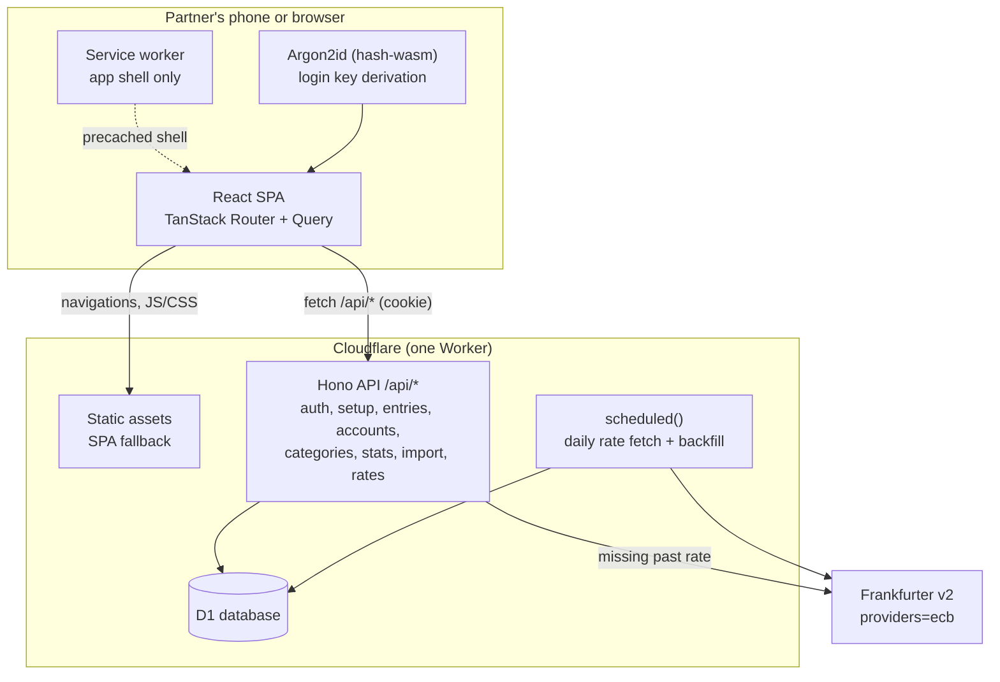
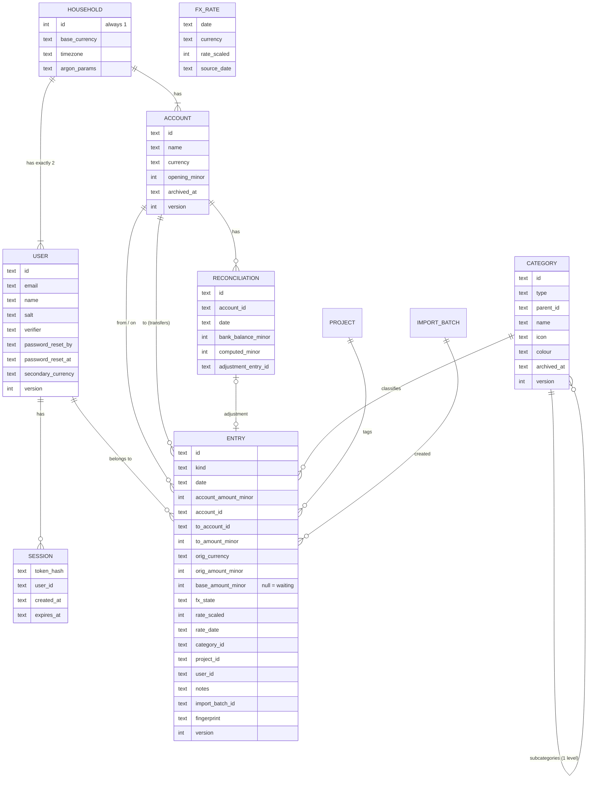
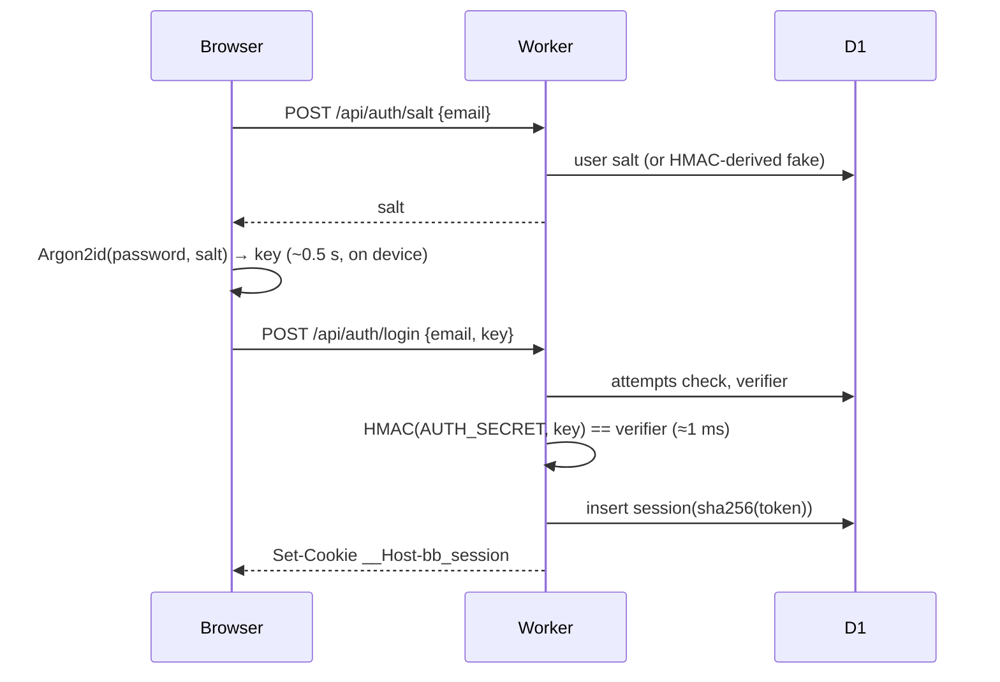
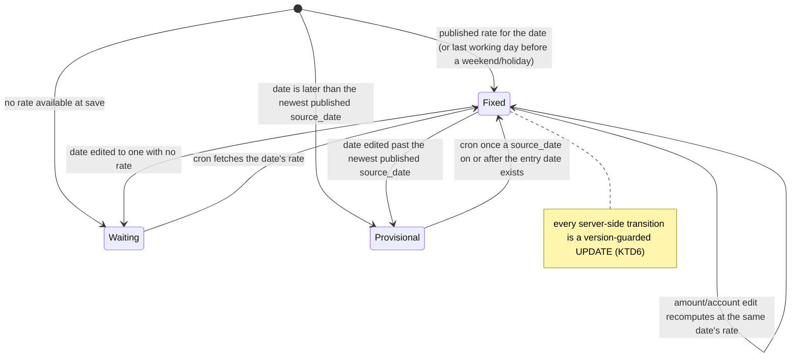

# Brutal Budget Next - Plan

## Goal Capsule

- **Objective:** A couple can run their household finances on their own free Cloudflare deployment of an open-source app. They log every expense and income by hand, see each month's money in and out by category, and keep every account balance in line with the bank.
- **Means:** A rebuild of Brutal Budget (`../brutal-budget`, Laravel/Inertia/Vue) as one Cloudflare Worker serving a Hono API and a React single-page app, backed by D1 (KTD1, KTD2).
- **Product authority:** The Product Contract below wins on product behaviour, and the Planning Contract's KTDs win on implementation mechanism within those constraints. Choices labelled `session-settled` are not reopened.
- **Execution profile:** Greenfield and Deep. Ships as one PR containing U1–U16, built in the Unit Index order.
- **Stop conditions:** Stop and ask the user if the U4 CPU spike shows that login or any common request regularly exceeds Cloudflare's free-plan 10 ms CPU limit. Also stop if Frankfurter can't supply one of the R22 currencies, or if the Deploy to Cloudflare flow can't create D1 and run migrations without code changes (R3).
- **Who finishes:** `ce-work` implements and verifies locally. A person makes the Deploy-button dry run and installs the PWA on a real iPhone and Android phone before calling v1 done.
- **Open blockers:** None. The license choice gates publishing, not building (see Open Questions).
- **Product Contract preservation:** Changed: added R41–R51 from planning defaults the user confirmed in the scoping synthesis. Resolved the login, exchange-rate provider and CSV-format questions in place. All other R/A/F/AE IDs are unchanged.

---

## Product Contract

### Summary

Brutal Budget Next is an open-source expense and income tracker for exactly two people who share a household. Each couple deploys their own copy to their own Cloudflare account. The app opens on the current month, and accounts with balances, transfers and reconciliation sit one screen away. It installs as a PWA on phones, works fully in a desktop browser, and ships every listed capability in v1.

### Problem Frame

The two users already track every shared expense by hand in Brutal Budget, and they value the "brutal" habit of looking at every expense. The current app has three problems.

It is a Laravel/PHP app, so it can't run fully on Cloudflare. It's built as a multi-tenant SaaS with teams, invitations, public sign-up, onboarding and API tokens, which is more machinery than one couple needs. It also can't answer two questions every household asks: how much came in versus went out this month, and whether each real account matches the app.

Without income, accounts or nested categories, the app covers only half of the household's money. The switch has to be complete on day one, because the couple won't run two apps side by side.

### Actors

- A1. Partner: one of the two household members. Both partners have identical rights and see all data.
- A2. Deployer: the person who sets up a copy on a Cloudflare account. This is usually one of the partners, but may be someone outside this household who found the open-source project.

### Key Decisions

- **One deployment per couple, with no public sign-up.** (session-settled: user-directed — chosen over a hosted multi-household service and over "self-host now, hosted later": avoids running a service and removes teams, invitations and onboarding.) Governs R1, R2, R3.
- **Shared household view only.** (session-settled: user-directed — chosen over balances with settle-up and over private per-person entries: the couple wants one combined picture, not a ledger of who owes whom.) Governs R4, R5.
- **Month-first app with accounts underneath.** (session-settled: user-directed — chosen over an accounts-first ledger and over adding category budgets: keeps the daily log-and-see-the-month loop fast.) Governs R6, R7.
- **Accounts have balances, transfers and reconciliation.** (session-settled: user-directed — chosen over accounts as plain labels and over balances without reconciliation: manual entry drifts, so the app has to show and correct the drift.) Governs R17–R21.
- **Reconciliation gaps are booked as adjustments that stay out of stats.** (session-settled: user-directed — chosen over booking an "Unreconciled" expense or income and over deciding case by case: categories and statistics never fill up with unknown entries.) Governs R20, R21.
- **One currency per account; foreign amounts are pre-converted and editable.** (session-settled: user-directed — chosen over conversion that can't be edited and over multi-currency wallet accounts: lets the entry match what the bank actually charged.) Governs R23, R24.
- **Household totals use the rate fixed on each entry's date.** (session-settled: user-directed — chosen over re-converting at today's rate: past months never change.) Governs R25.
- **Online only.** (session-settled: user-directed — chosen over offline capture with sync and over fully offline-first: least complexity.) The app shell may load offline but does not accept entries. Governs R30.
- **Generic CSV import instead of a dedicated migration.** (session-settled: user-directed — chosen over a one-off import from the old app's database and over starting fresh: anyone can use it, and the couple's history comes in through a CSV export.) Governs R26–R29, R48.
- **Everything ships in v1.** (session-settled: user-directed: the couple switches only when the new app covers everything listed here.)
- **Stack: one Cloudflare Worker serving a Hono API and a React + Vite single-page app as static assets, with D1 as the database and a Cron Trigger for daily exchange rates.** (session-settled: user-directed — chosen over a Vue single-page app, Nuxt on Workers, and other full-stack frameworks: larger React ecosystem and contributor pool, user fluency, and no need for server rendering in a private app.) Planning picks the libraries inside this shape. Governs R3, R22, R30.
- **Email and password login, with the expensive hashing done on the partner's device.** (session-settled: user-directed — chosen over passkeys only, passkeys plus password, and requiring Workers Paid: strong server-side hashing takes about 60 ms CPU and Workers Free allows 10 ms, so this is the only option that keeps the free tier and works on every device.) Governs R51.
- **One always-visible add button opens a single right-side drawer, with a type switch inside.** (session-settled: user-directed — chosen over a speed-dial menu and over an expense-only button: an expense stays one tap, as in the old app.) Governs R7, R31, R32.
- **Smart defaults in the drawer, with no default category.** (session-settled: user-approved — chosen over a fixed default account per partner and over remembering the last category: speed without silent mis-categorising.) Governs R33.
- **Keep the old navigation: top bar on desktop, hamburger on mobile.** (session-settled: user-directed — chosen over a bottom tab bar with a floating button and over a centre "+" tab: least change from what the couple already uses.) Governs R35.
- **Numbers-first visual style.** (session-settled: user-directed — chosen over a neo-brutalist look and over a calm, rounded default: the "brutal" honesty comes from starkness and big readable numbers, not decoration.) Governs R37.
- **Category icons stay Tabler line icons, not emojis.** (session-settled: user-directed — chosen over native, bundled colour and monochrome emojis: line icons fit the numbers-first style, look the same on every device, and old categories carry over directly.) Governs R39.
- **Two levels of categories, with separate category sets for expenses and income.** Two levels covers the needs that came up ("Food > Groceries") without building a tree editor. Expense and income categories mean different things. Governs R9, R10.
- **Archive instead of delete, fixed currencies, and locked entry types.** (session-settled: user-approved — chosen over hard deletes, editable currencies and convertible entry types: each of those silently rewrites history or balances.) Governs R44, R45, R46.

### Requirements

**Household and access**

- R1. A copy of the app serves one household with exactly two partner logins. There is no public sign-up, and no third login can be created.
- R2. The two logins are created during first-run setup of a fresh deployment. After setup, the setup path is closed.
- R3. A deployer can deploy and run the app on Cloudflare services alone, within the free tier for normal household use, by following the README without changing code. The project is published as open source.
- R4. Both partners see and can change all data: every entry, account, category, project and setting.
- R5. Every expense and income records which partner it belongs to, and lists and totals can be filtered by partner.
- R41. First-run setup needs a setup secret that the deployer sets during deploy. Setup creates the base currency, both logins and the first account in one step, and nothing is saved if it is abandoned partway.
- R42. Each partner can change their own password, and either partner can reset the other's. The README documents a command-line reset for when both are locked out. No email is ever sent.
- R51. Partners log in with email and password, and a login lasts 30 days, extended by use.

**Month view and entries**

- R6. The home screen shows the selected month: total income, total expenses, the net result, totals by category with subcategory breakdown, and the month's entries grouped by date. The user can step to previous and next months.
- R7. An add button is always visible on every screen: a round floating button at the bottom right on mobile, and a "+ Add" button in the top bar on desktop. One tap or click opens the entry drawer (R31) ready for an expense.
- R8. An expense or income records amount, currency, date, account, category or subcategory, partner, optional project, and optional notes. It can be edited and deleted, and swipe-to-delete works on touch devices.
- R9. Categories have a name, icon and colour, and each can have subcategories. An entry can sit on a category or on one of its subcategories, and subcategory totals roll up into their parent.
- R10. Expense categories and income categories are separate sets.
- R40. A subcategory always uses its parent's colour and has its own icon, which defaults to the parent's icon.
- R11. Each category has a detail page showing its monthly totals over time and its entries.
- R12. Projects are colour-coded tags, such as "Japan trip", that can be applied to both expenses and income. Each project has a page with its total and entries across categories.
- R46. A saved entry's type (expense, income or transfer) can't be changed. The type switch only appears for new entries.
- R49. When both partners edit the same item, the second save is rejected with a message to reload, so neither edit is silently overwritten.
- R50. Deleting an entry, including by swipe, shows an undo option for a few seconds.

**Statistics**

- R13. A statistics view shows the selected year by month: income, expenses and net, plus a per-category breakdown. It shows at least what the old dashboard and statistics pages show.
- R14. Statistics, month totals and category totals exclude transfers (R19) and balance adjustments (R20).
- R15. All household totals and statistics are shown in one household base currency, chosen at setup.
- R16. Each partner can set a personal secondary display currency and switch totals to it. This is display only and uses the current rate.

**Accounts**

- R17. The household can create accounts, such as a joint current account, a personal card, cash or savings. Each account has a name, one currency and an opening balance. Accounts can be archived but not hard-deleted while entries refer to them.
- R18. The accounts screen shows every account's current balance and history. The balance is the opening balance plus income, minus expenses, plus or minus transfers and adjustments.
- R19. A transfer moves money between two accounts. It records the amount that left one account and the amount that arrived in the other, and those differ when the currencies differ (per R23).
- R20. Reconciling an account means entering the real bank balance on a date. The app shows the difference from its computed balance and can book the gap as a balance adjustment on that account.
- R21. A balance adjustment changes only that account's balance. It shows in the account's history, marked as an adjustment, and appears in no income, expense, category, project or statistics total.
- R43. Reconciling doesn't lock older entries. If entries dated on or before the last reconciliation change afterwards, the account shows that it changed since that reconciliation and by how much.

**Data rules**

- R44. Categories, subcategories, projects and accounts that entries refer to are archived instead of deleted. Archived items leave the pickers but stay in history and statistics. Delete is allowed only when nothing refers to the item. A category can be merged into another category of the same type, which moves its entries. An account with a non-zero balance can be archived after a warning.
- R45. An account's currency can't change once the account has entries, and the household base currency can't change after setup.

**Currency**

- R22. Entries and accounts support at least the 14 currencies of the old app (EUR, USD, GBP, JPY, CAD, AUD, CHF, CNY, INR, BRL, DKK, NOK, SEK, ISK), and the app keeps daily exchange rates up to date automatically.
- R23. When an entry's or transfer's currency differs from its account's currency, the amount in the account's currency is pre-filled at that date's rate, and the user can overwrite it with what the bank actually charged.
- R24. A foreign-currency entry keeps both its original amount and currency and the amount booked to the account, and the entry list shows both.
- R25. Each entry's value in the base currency is fixed using the rate for the entry's date, so totals for past periods don't change when rates move later.
- R47. A missing exchange rate never blocks saving. Dates with no published rate use the most recent earlier rate. When no rate is available at all, the entry saves marked as waiting for a rate and is filled in automatically later. An entry's base value is derived from its account amount.

**Import**

- R26. The README documents the CSV format the app accepts.
- R27. A partner can upload a CSV of expenses and income. Before anything is saved, the app shows a preview with row-level errors.
- R28. During import, the user chooses the target account for rows that name none. Categories, subcategories and projects named in the file are matched to existing ones by name, or created.
- R29. Importing the same file twice does not silently duplicate entries.
- R48. Import never creates accounts and does not import transfers. The preview maps each account name in the file to an existing account, and a whole import can be undone.

**Interface**

- R31. One entry drawer handles creating, editing and deleting expenses, income and transfers. It slides in from the right, fills the screen on mobile, and is a side panel on desktop. Tapping an existing entry opens it in the same drawer.
- R32. A segmented control at the top of the drawer switches between Expense, Income and Transfer, and the drawer opens on Expense. Switching changes the fields: Income uses income categories (R10), and Transfer shows a from-account, a to-account and a second amount when the currencies differ (R19).
- R33. When the drawer opens for a new entry, the amount field has focus (the numeric keyboard on mobile). Fields are prefilled with partner = the logged-in partner, date = today, account = the last account this partner used for that entry type, and currency = that account's currency. Category has no default; instead, the partner's most-used categories appear as one-tap chips above the full list. Project and notes sit under a "More" fold.
- R34. On desktop, a keyboard shortcut opens the drawer for a new entry, and Enter saves.
- R35. Navigation follows the old app: a top bar on desktop with Month, Accounts, Statistics, Categories, Projects and Settings, and a hamburger menu with the same items on mobile.
- R36. Reconciliation (R20) starts from an account's screen, not from the add button.
- R37. The visual style is numbers-first and close to monochrome. It uses generous whitespace, large tabular-figure numbers, and thin rules instead of heavy cards. The only colours are user-chosen category colours and red/green for the net result.
- R38. The app supports light and dark mode, follows the system setting by default, and has a manual override in Settings.
- R39. Category icons come from the same icon set as the old app (Tabler), so existing categories and icon names in imported files carry over unchanged.

**Platform**

- R30. The app is an installable PWA on iOS and Android, and works fully in current desktop browsers with a layout that uses the wider screen. With no connection, it shows an offline state instead of accepting entries.

### Key Flows

- F1. First-run setup
  - **Trigger:** A deployer opens a fresh deployment.
  - **Actors:** A2, A1
  - **Steps:** Enter the setup secret. Choose the household base currency, create two partner logins, and create at least one account with an opening balance. Default expense and income categories are offered and can be edited later.
  - **Outcome:** The app opens on the current month, and setup can't be reached again.
  - **Covered by:** R1, R2, R15, R17, R41
- F2. Log an expense abroad
  - **Trigger:** A partner pays ¥3,000 with the EUR joint card.
  - **Actors:** A1
  - **Steps:** Tap add, enter ¥3,000, and pick the joint account, category and partner. The account amount pre-fills at that day's rate, and the partner overwrites it with the bank's charge. Save.
  - **Outcome:** The entry shows both amounts, the joint account's balance drops by the bank's charge, and the month totals include it at the rate fixed on its date.
  - **Covered by:** R7, R8, R23, R24, R25
- F3. Reconcile an account
  - **Trigger:** A partner checks the bank app and sees a different balance from the app's.
  - **Actors:** A1
  - **Steps:** Open the account, choose reconcile, and enter the bank balance. The app shows the gap. The partner either goes and adds the missing entries, or books the remaining gap as an adjustment.
  - **Outcome:** The account balance matches the bank, and no category or statistics total has changed.
  - **Covered by:** R20, R21, R14, R43
- F4. Bring history over from the old app
  - **Trigger:** The couple switches from Brutal Budget.
  - **Actors:** A1
  - **Steps:** Export the old data to the documented CSV format, upload it, and review the preview. Map the file's account names and pick the target account for rows without one, then confirm.
  - **Outcome:** Past months appear in the month view and statistics with the old categories, projects and currencies.
  - **Covered by:** R26–R29, R48

### Acceptance Examples

- AE1. **Covers R19, R14.** **Given** a joint EUR account and a DKK savings account, **when** a partner transfers €500 that arrives as 3,725 kr, **then** joint drops €500, savings rises 3,725 kr, and the month's income and expense totals are unchanged.
- AE2. **Covers R20, R21.** **Given** the joint account shows €2,410 and the bank shows €2,385, **when** the partner books the €25 gap as an adjustment, **then** joint shows €2,385, the adjustment appears in the joint history, and the month's expenses do not grow by €25.
- AE3. **Covers R25.** **Given** a USD 100 expense in March 2026, booked when 1 USD = €0.92, **when** the rate later moves to €0.85, **then** March 2026's totals still count it as €92.
- AE4. **Covers R9.** **Given** "Food" with subcategories "Groceries" and "Restaurants", **when** €40 is logged on Groceries and €10 directly on Food, **then** the month view shows Food €50, split into Groceries €40 and €10 on Food itself.
- AE5. **Covers R1, R2, R41.** **Given** a deployment where setup is finished, **when** anyone opens the setup path or calls the setup API, **then** no new login can be created.
- AE6. **Covers R30.** **Given** a partner's phone has no signal, **when** they open the installed app and try to add an expense, **then** the app says it is offline and the entry is not silently lost or half-saved.
- AE7. **Covers R29.** **Given** a CSV that was already imported, **when** it is uploaded again, **then** the preview flags the rows as already imported and does not add duplicates by default.
- AE8. **Covers R43.** **Given** joint was reconciled to €2,385 on 31 October, **when** a partner later deletes a €12 expense dated 20 October, **then** joint shows it changed by +€12 since the 31 October reconciliation.
- AE9. **Covers R47.** **Given** no rate for the entry's date has been fetched and Frankfurter is unreachable, **when** a partner saves a USD expense on the EUR account with the account amount typed in, **then** the entry saves and is marked as waiting for a rate. The month total shows how many entries are waiting. After the next successful rate fetch, the entry has its base value.

### Success Criteria

- The couple stops using the old Brutal Budget within the first week of switching, with their history imported.
- Someone who has never seen the code deploys their own copy on a free Cloudflare account by following the README.
- On a phone, logging an everyday expense in the base currency takes no longer than in the old app.

### Scope Boundaries

**Deferred for later**

- Recurring or scheduled entries, such as salary and rent. This is the most likely first request after v1.
- Monthly category budgets with "remaining" amounts.
- Offline entry with later sync.
- Data export, beyond what is needed to move history in.
- Passkey login as an alternative to passwords.
- A combined "net worth" total across accounts in different currencies.
- Moving an existing category to become a subcategory of another one, and promoting a subcategory to a category.

**Outside this product's identity**

- Bank connections or automatic transaction import. Every expense is typed by hand, which is the point of "brutal".
- Splitting expenses, balances between partners, and settling up.
- Private per-partner entries or accounts hidden from the other partner.
- More than two users, teams, invitations, public sign-up, and hosting many households on one deployment.

**Dropped from the old app**

- Push notifications, the regular/one-off expense flag, the onboarding checklist, API tokens, and team management.

**Considered and not built**

- A server-side data cache (Workers KV or the Cache API). Household data is a few thousand rows a year, and the old app's cached totals were its main source of bugs. Revisit only if a measured screen is slow (KTD8).
- Live push of the other partner's changes. Refetching when the app regains focus is enough for two people, and R49 catches conflicting edits.
- Email for password reset. It would add an external dependency for a two-person app where the other partner can reset the password (R42).
- Rotating `AUTH_SECRET` without password resets (a versioned pepper with re-HMAC on login). Rotation is rare, and a CLI reset of two users covers it. Adding the version column later is a trivial migration on a two-row table.
- Raising Argon2 parameters after setup. It would need both partners to re-derive. Revisit if the tuned parameters prove too weak.

### Deferred to Follow-Up Work

- A monthly summary table for statistics, built only if a measured screen is slow (KTD8).

### Dependencies / Assumptions

- Frankfurter (`api.frankfurter.dev`, ECB data) serves daily and historical rates for all R22 currencies, ISK included. It was checked live on 2026-11-06, and needs no API key.
- Cloudflare's free tier covers one household: Workers allow 100k requests a day and 10 ms CPU per request, and D1 allows 5M rows read and 100k rows written per day. Requests for static assets don't count toward the Worker request limit.
- The old app has no CSV export (`../brutal-budget/app` and its routes contain no export code). A one-off SQL query documented in this repo turns the old database into the R26 format.

### Sources / Research

- Old app: `../brutal-budget`, Laravel 12, Jetstream teams, Inertia and Vue.
  - Data model: `../brutal-budget/database/migrations/2025_01_28_203318_create_expenses_table.php`, `..._create_categories_table.php` and `..._create_projects_table.php`.
  - Totals: `../brutal-budget/app/Helpers/Totals.php` (TODO at line 20) and `CategoryMonthlyTotal` are rebuilt by `ExpenseObserver` in the acting user's currency at the latest rate. Six recent fix commits touch this, and KTD8 avoids the pattern.
  - Money: amounts are stored as `round(x*100)`, which is wrong for JPY and ISK. KTD5 replaces it with per-currency minor units.
  - FX: `../brutal-budget/app/Console/Commands/LoadExchangeRates.php` uses ExchangeRate-API, stores only the latest rate, and isn't scheduled in code.
  - Icons: Tabler component names stored as strings, with 63 listed in `../brutal-budget/resources/js/Pages/Categories/Partials/CategoryIcons.js`. Colours are 17 Tailwind hues in shades 300/500/700, stored as hex.
  - Swipe-to-delete: `../brutal-budget/resources/js/Pages/Expenses/Partials/ExpenseItem.vue` (deletes past 150px, with no undo).
  - Charts: `BarsChart.vue` (a stacked bar per category per month) and `DonutChart.vue` (current month by category).
- Cloudflare docs: Workers limits (https://developers.cloudflare.com/workers/platform/limits/), the Vite plugin, SPA routing and `run_worker_first`, D1 limits and `batch()` atomicity, Cron Triggers, Deploy buttons (https://developers.cloudflare.com/workers/platform/deploy-buttons/).
- Password hashing CPU cost, benchmarked locally with WebCrypto: PBKDF2-SHA256 takes 6 ms at 50k iterations, 22 ms at 210k and 61 ms at 600k, and scrypt N=16384 takes 28 ms. A third party measured about 66 ms in workerd.
- Drizzle: stable 0.45.x with drizzle-kit 0.31 writes flat SQL migrations that `wrangler d1 migrations apply` reads directly. Version 1.0 is still a release candidate.
- Frankfurter: v1 is deprecated but still works, and v2 with `providers=ecb` keeps pure ECB rates. Weekend dates return the previous working day.

---

## Planning Contract

### Key Technical Decisions

- KTD1. **Single package, with three source roots inside one Worker deploy.** `src/client` holds the React SPA, `src/worker` the Hono API, and `src/shared` the types, Zod schemas and money/FX maths used by both. Vite with `@cloudflare/vite-plugin` builds both. `wrangler.jsonc` serves assets with `not_found_handling: "single-page-application"` and `run_worker_first: ["/api/*"]`, so only API calls invoke the Worker. A monorepo would add tooling and nothing else at this size. Instantiates the stack Key Decision (R3, R22, R30).
  - Static responses never pass through the Worker, so their security headers come from `public/_headers`:
    - `Content-Security-Policy: default-src 'self'; script-src 'self' 'wasm-unsafe-eval'; connect-src 'self'; img-src 'self' data:; style-src 'self' 'unsafe-inline'; object-src 'none'; base-uri 'none'; frame-ancestors 'none'`. The `'wasm-unsafe-eval'` source is what hash-wasm needs.
    - `X-Content-Type-Options: nosniff`, `Referrer-Policy: same-origin` and HSTS.
  - API responses add `Cache-Control: no-store` in Hono.
- KTD2. **Libraries:**
  - **Hono 4** for the API.
  - **React 19**, **TanStack Router** (typed file routes) and **TanStack Query** (KTD8) on the client.
  - **Tailwind 4** with **shadcn/ui** components themed to R37, **@tabler/icons-react** for icons (R39), **Recharts** for charts.
  - **Zod** schemas shared between client forms and Hono validators.
  - **Drizzle ORM 0.45 stable** with **drizzle-kit 0.31**, whose flat SQL migrations are applied only by `wrangler d1 migrations apply`, never by `drizzle-kit migrate`.
  - **vite-plugin-pwa** for the shell.
  - **hash-wasm** for Argon2id in the browser.
  - **Vitest** with `@cloudflare/vitest-pool-workers` for API tests on a real local D1, plus **Playwright** for end-to-end tests.
  - Better Auth was rejected: its default scrypt busts the CPU limit, and its framework weight is unnecessary for two users and a custom password scheme (KTD3).
- KTD3. **Hand-rolled auth with browser-side Argon2id ("server relief").** Instantiates the login Key Decision, governs R51, R42 and R41.
  - **Login:**
    1. The client fetches the user's salt.
    2. It derives a 32-byte key from the password with Argon2id (about 64 MiB of memory, tuned to roughly 0.5 s on a mid-range phone).
    3. It sends the key, never the password.
  - **Server:** stores `HMAC-SHA256(AUTH_SECRET, "verifier" ‖ key)` and compares it in constant time, at about 1 ms CPU. The derived key is equivalent to the password, but a leaked verifier can't be replayed or cracked without `AUTH_SECRET`.
  - **Rotating `AUTH_SECRET`:** this requires a CLI reset for both partners, as the README documents. Rotation without resets was considered and not built (Scope Boundaries).
  - **`AUTH_SECRET` strength:** it must be at least 32 characters, checked on every auth and setup request. A shorter value makes them fail with a clear configuration error. `.dev.vars.example` holds empty values, so an unedited example always fails this check.
  - **Argon2id parameters:**
    - The parameters are household-wide: they are stored on the household row, fixed at setup, and the same for both partners.
    - A constant floor in `src/shared` (memory ≥ 19 MiB, iterations ≥ 2, parallelism = 1) bounds them. Setup rejects any set below the floor, and the client refuses to derive below it.
    - Each user has their own 16-byte random salt, generated on the client.
    - Raising the parameters later is deferred: it would require both partners to re-derive.
  - **Unknown emails:** the salt endpoint returns a deterministic fake salt derived as `HMAC(AUTH_SECRET, "fake-salt" ‖ email)`, together with the household's parameters. A fake reply is identical in shape to a real one, so the endpoint can't be used to find accounts.
  - **Sessions:**
    - A random 256-bit token sent in a `__Host-bb_session` cookie (HttpOnly, Secure, SameSite=Lax), stored in D1 only as its SHA-256.
    - Sessions last 30 days and slide with use, up to an absolute cap of 90 days from creation (see Open Questions).
    - A self-service password change revokes all of that user's sessions except the current one. A partner reset revokes all of the target partner's sessions.
  - **CSRF:**
    - Applies to every non-GET `/api/*` request, including auth and setup.
    - The `Origin` header must equal the request URL's own origin, and a missing `Origin` is rejected. This still works if a deployer serves the app from both workers.dev and a custom domain.
    - `Content-Type: application/json` is required, and no CORS is allowed.
    - GET handlers have no side effects other than sliding the session.
  - **Brute force:**
    - **Per IP:** the Workers Rate Limiting binding limits `/api/auth/*` and `/api/setup` before any D1 access, so floods can't use up D1's write quota.
    - **Per email and IP:** one upserted counter row per pair in D1, with a lockout for that pair only.
    - **Per email across all IPs:** an increasing server-side delay on each attempt, capped at 30 s, with no 429. A correct key is never refused because of failures from other IPs, so a remote attacker can't lock a partner out.
    - **Unknown emails** are counted the same way.
  - **Sensitive changes need the current key:** a password change, an email change and a partner reset all require the acting partner's current key, re-derived on the device.
  - **Logging:** auth and setup handlers never log request bodies.
- KTD4. **One `entries` table with a `kind` column of `expense`, `income`, `transfer` or `adjustment`, plus positive amounts whose direction comes from the kind.**
  - **Transfers** are one row: the from-account and its amount, plus the to-account and its amount.
    - `to_amount_minor` is always written, equal to the from amount when the currencies match, so the receiving balance can never miss it. A CHECK enforces this.
    - A single row can never leave half a transfer behind, and it needs no batch to stay consistent. This beats the two-leg model used by Actual and Firefly III, which suits apps that have many legs. This app never has more than two.
  - **Adjustments** carry a signed amount and point to their reconciliation. They are created and removed only through their reconciliation (KTD13), never edited or deleted through the entries API.
  - **Balances** are computed per account with SQL `SUM` over these rows plus the opening balance, never stored (R18).
- KTD5. **Money is held as integer minor units with a per-currency exponent** (JPY and ISK use 0, the rest 2), defined once in `src/shared/money`.
  - Rates are stored as integers scaled by 10^10 and converted with BigInt.
  - Rounding is half-to-even at the target currency's exponent, so client prefill and server calculation produce identical numbers.
  - Display uses `Intl.NumberFormat` with tabular figures.
  - This fixes the old app's ×100 bug for JPY and ISK.
- KTD6. **Exchange rates are stored per calendar day in D1, fetched from Frankfurter v2 with `providers=ecb` and EUR as the pivot.** Governs R22, R23, R25 and R47.
  - **Daily fetch:** two Cron Triggers, `0 16 * * *` and `0 22 * * *` UTC, fetch the day's rates. Both run after ECB publishes at about 16:00 CET (15:00 UTC in winter, 14:00 UTC in summer). The second is a retry for a late or failed first run.
  - **Rate rows:** each row is keyed by calendar date and currency, and stores `source_date`, the date the provider actually published.
    - On weekends, on holidays and before publication, the row is copied forward with `source_date` earlier than its date.
    - An upsert replaces a row whenever a newer `source_date` arrives, so an early copied row is corrected by the evening run.
    - Every lookup is a single-key read.
  - **"Today" and the timezone:** the household stores a timezone chosen at setup. "Today", for drawer defaults, the cron and rate state, is defined in that zone.
  - **Rate state of an entry (`fx_state`):** one of three values.
    - `fixed`: the rate used was published for the entry's date or for the last working day before it (weekend or holiday).
    - `waiting`: no rate was available.
    - `provisional`: the entry's date is later than the newest `source_date` the provider has published, which covers today before publication and future dates.
  - **Cron job duties:** each run backfills missing days and fills `waiting` entries. It also fixes every `provisional` entry whose date is now on or before the newest published `source_date`, using that date's stored row. A weekend or ECB-holiday entry therefore becomes `fixed` at the last working day's rate as soon as a later working day is published.
  - **Safe cron writes:**
    1. The server reads the row's account amount and `version`.
    2. It computes the base value in the Worker with the shared U2 maths. No conversion arithmetic is ever done in SQL.
    3. It writes with `UPDATE … SET base_amount_minor = ?, fx_state = ?, version = version + 1 WHERE id = ? AND version = ?`.

    A partner's edit in between makes the guard skip the row until the next run, so it never overwrites the edit.
  - **On-demand fetch:** the rate endpoint used for drawer prefill fetches a missing past date from Frankfurter, as one subrequest.
  - **Cross rates:** computed via EUR.
  - **Fixing the base value:** an entry's base value is its account amount converted at the rate for its date, and is fixed when its state is `fixed` (R25, R47). An edit to the date or amount re-evaluates the state.
- KTD7. **The secondary display currency is converted on the client.** The API returns the latest rates with each screen, and the client converts base totals for display (R16). The per-partner setting lives on the user row. Nothing is stored in the secondary currency.
- KTD8. **No server-side data cache. Speed comes from:**
  - a TanStack Query cache on the client, with optimistic mutations and rollback;
  - one API call per screen, whose queries run as a single D1 `batch()`;
  - indexes on `(date)`, `(account_id, date)` and `(category_id, date)`;
  - a README note to create D1 near the household.

  (session-settled: user-approved — chosen over a Workers KV or Cache API data cache: tiny data volume, and stale cached totals caused six of the old app's bug fixes.) A monthly summary table is deferred until a screen measurably needs it.
- KTD9. **Writes are atomic and conflict-aware.**
  - IDs are UUIDv7 strings generated by the client for creates. A retried create whose stored row matches the request (same table, same normalised payload) returns that row with 200. An existing id with a different payload returns 409, so a reused id can never report a save that didn't happen.
  - Every mutable row has a `version` integer. Updates and deletes send the version they loaded and match on it. Zero rows affected means 409 Conflict (R49). Deleting a row that is already gone returns 204.
  - The 409 message reads "This changed since you opened it — reload", because the cron's rate fix (KTD6) also bumps versions, not only the partner's edits.
  - Multi-row writes (setup, reconciliation with adjustment, category merge, import chunks) run in one `db.batch()`.
- KTD10. **Setup is guarded by a `SETUP_TOKEN` secret and a singleton household row.**
  - The `.dev.vars.example` file lists `SETUP_TOKEN` and `AUTH_SECRET`, so the Deploy button prompts for both, and `secrets.required` makes a manual deploy fail if either is missing.
  - The setup endpoint inserts the household row (`id = 1`, enforced by a CHECK) with the base currency and timezone, both users, the first account and the default categories in one batch. A second or concurrent setup fails on the primary key, and the endpoint returns 404 once a household exists (R41, AE5).
  - `SETUP_TOKEN` must be at least 32 characters, and setup reports a clear error otherwise. The README gives a command to generate one.
  - Both the stored and the submitted token are SHA-256 hashed before a timing-safe compare, so the inputs always have equal length. `/api/setup` sits behind the same per-IP rate limit as login (KTD3).
- KTD11. **CSV is parsed in the browser and committed in chunks.** Governs R27–R29 and R48.
  - **Parsing:** PapaParse in the browser, because Worker CPU can't afford parsing large files.
  - **Preview:** the client validates and builds the preview. The server checks fingerprints in the same ~200-row chunks as the commit and returns which rows were already imported. The client sends each row's occurrence index within the whole file, so fingerprints stay stable across chunks.
  - **Fingerprint:** a versioned hash (`v1:` prefix) computed on the server over canonical fields:
    - date, kind, minor units and currency code;
    - the mapped account id (not the file's account name);
    - the category path and the notes, both trimmed, NFC-normalised and case-folded;
    - the occurrence index of identical rows within the file.

    Two identical coffees on the same day survive, and a re-upload matches even with different whitespace or mapping order.
  - **Commit:**
    - Chunks of about 200 rows per request, each sized under D1's 100 bound-parameter limit per statement and written in one batch.
    - Every row carries an `import_batch_id`, so undo deletes by batch.
    - Inserts use `ON CONFLICT(fingerprint) DO NOTHING` and report inserted and skipped counts, so a retried chunk succeeds and skips rows already present. v1 has no override to import duplicates.
    - Before commit, the client asks the server to fill rates for the file's date range in windows of at most 90 days. Each window is one request and one Frankfurter time-series call, so every request stays within the CPU budget.
  - **Undo:** before undoing, the app shows how many entries from the batch were edited since import or fall on or before a reconciliation, and asks for confirmation.
- KTD12. **The deploy script runs migrations before deploying.** `package.json` defines `build` as `vite build` and `deploy` as applying D1 migrations to the `DB` binding remotely and then running `wrangler deploy`. The D1 binding has no `database_id`, so the Deploy button provisions it. The README offers the button and manual `wrangler` steps.
- KTD13. **Reconciliations are rows of their own:** account, date, the bank balance entered, the computed balance at that moment, and the optional adjustment entry.
  - **Booking:** the client sends the computed balance it showed, and the server writes one batch.
    1. It inserts the adjustment with `INSERT … SELECT … WHERE` the account's computed balance as of that date still equals the shown balance.
    2. It inserts the reconciliation unconditionally, referencing the adjustment id.

    If the guard fails, the reconciliation's foreign key (RESTRICT, KTD15) aborts the whole batch, and the server returns 409. With a zero gap, only the reconciliation is inserted, guarded on the same balance check. Two partners booking the same gap at once therefore produce exactly one adjustment.
  - **Removing:** deleting a reconciliation deletes its adjustment in the same batch.
  - **Changed since last reconcile (R43):** the current computed balance as of that date minus the stored bank balance, shown when it isn't zero.
- KTD14. **Statistics and totals are SQL aggregates over the fixed base value.** They group by month and by top-level category (`COALESCE(parent_id, id)`), exclude transfers, adjustments and entries waiting for a rate, and return a count of waiting entries to display. Responses stay small to respect the 10 ms CPU budget.
- KTD15. **Archive rather than delete, enforced by the database rather than read-then-write checks.**
  - Every archivable table gets an `archived_at` column.
  - **Foreign keys:** every reference is a declared foreign key.
    - Entries' links to accounts (`account_id` and `to_account_id`), categories, projects, users and import batches, and `reconciliations.adjustment_entry_id`, all use RESTRICT. A project that entries refer to is therefore archived, never deleted (R44).
    - Nothing that holds money uses CASCADE.
  - **Delete in use:** deleting an item that is still referenced hits a foreign key error, which is mapped to 409 (R44). A D1 batch can't abort based on the result of a SELECT, so there is no separate check step.
  - **Locked currency (R45):** changing an account's currency is one conditional statement, `UPDATE … WHERE NOT EXISTS` any entry referencing the account as `account_id` or `to_account_id`, so it can't race a first entry. The household base currency is rejected outright after setup.
  - **Table rebuilds:** migrations that rebuild tables run with `PRAGMA defer_foreign_keys = ON`.

### High-Level Technical Design

**Components and request paths**



**Data model**



**Login: hashing on the device, a cheap check on the server**



**An entry's base value over its life (R25, R47)**



### Output Structure

```text
brutal-budget-next/
  src/
    client/            React SPA: routes/, components/, drawer/, features/, lib/
    worker/            Hono app: index.ts (fetch + scheduled), routes/, db/, auth/, fx/, services/
    shared/            money/, fx-math/, schemas/ (Zod), api-types
  migrations/          drizzle-kit generated SQL, applied by wrangler
  tests/
    worker/            vitest-pool-workers API tests
    e2e/               Playwright flows
  scripts/             reset-password, export-from-brutal-budget.sql
  docs/                csv-format.md, migrating-from-brutal-budget.md, plans/
  public/              icons, manifest assets
  wrangler.jsonc  vite.config.ts  drizzle.config.ts  .dev.vars.example  README.md
```

### Assumptions

- Argon2id at about 64 MiB and 3 iterations finishes within about 1 s on the couple's phones. U4 tunes the parameters and stores them per user, so they can be raised later without locking anyone out.
- `vite-plugin-pwa` works alongside `@cloudflare/vite-plugin` when scoped to the client environment. U1 proves this first.
- The Deploy button creates D1 before the deploy script's migration step runs. U16 proves this with a throwaway account.

### Sequencing

U1 builds the scaffold and runs the build and CPU spikes. U2 and U3 lay down the money core and the schema that everything else uses. U4 and U5 make the app reachable and safe. U6 adds rates before U7 adds entries, which need them. The UI shell (U10) comes before the feature screens. Import (U15) comes last of the features, because it reuses entries, categories and rates. U16 finishes the PWA and docs and runs the deploy dry run.

---

## Implementation Units

| U-ID | Title | Key files | Depends on |
|---|---|---|---|
| U1 | Scaffold, build pipeline, spikes | `vite.config.ts`, `wrangler.jsonc`, `package.json`, `src/worker/index.ts`, `src/client/main.tsx` | none |
| U2 | Money and FX maths core | `src/shared/money/*`, `src/shared/fx-math/*` | U1 |
| U3 | Database schema and migrations | `src/worker/db/schema.ts`, `migrations/*`, `drizzle.config.ts` | U1 |
| U4 | Auth and sessions | `src/worker/auth/*`, `src/client/features/auth/*`, `scripts/reset-password.*` | U3 |
| U5 | First-run setup | `src/worker/routes/setup.ts`, `src/client/routes/setup.tsx` | U4 |
| U6 | Exchange-rate service and cron | `src/worker/fx/*`, `src/worker/index.ts` | U2, U3 |
| U7 | Entries API | `src/worker/routes/entries.ts`, `src/worker/services/entries.ts` | U4, U6 |
| U10 | App shell, navigation, theming | `src/client/routes/__root.tsx`, `src/client/components/layout/*`, `src/client/lib/query.ts` | U4 |
| U11 | Entry drawer | `src/client/drawer/*` | U7, U10 |
| U12 | Month view | `src/client/routes/index.tsx`, `src/worker/routes/month.ts` | U7, U10 |
| U8 | Accounts and reconciliation | `src/worker/routes/accounts.ts`, `src/client/routes/accounts/*` | U7, U10 |
| U9 | Categories and projects | `src/worker/routes/categories.ts`, `src/worker/routes/projects.ts`, `src/client/routes/categories/*`, `src/client/routes/projects/*` | U7, U10 |
| U13 | Statistics | `src/worker/routes/stats.ts`, `src/client/routes/statistics.tsx` | U7, U10 |
| U14 | Settings | `src/worker/routes/settings.ts`, `src/client/routes/settings.tsx` | U4, U10 |
| U15 | CSV import | `src/client/features/import/*`, `src/worker/routes/import.ts`, `docs/csv-format.md` | U7, U9, U6 |
| U16 | PWA, README, deploy dry run | `vite.config.ts`, `public/*`, `README.md`, `docs/*` | all |

### U1. Scaffold, build pipeline, spikes

**Goal:** a single Worker that serves a React shell and a `/api/health` route, builds, runs locally with D1, and has every test runner wired up.

**Requirements:** R3, R30. Implements KTD1, KTD2 and KTD12.

**Dependencies:** none.

**Files:**
- Build and config: `package.json`, `vite.config.ts`, `wrangler.jsonc`, `tsconfig*.json`, `.gitignore`, `.dev.vars.example`, `drizzle.config.ts`.
- Entry points: `src/worker/index.ts`, `src/client/main.tsx`, `src/client/index.html`.
- Test config: `vitest.config.ts` (projects: shared, client, worker), `playwright.config.ts`, `tests/worker/health.test.ts`.
- CI: `.github/workflows/ci.yml`.

**Approach:**
1. Use Vite 8 with the React plugin and `@cloudflare/vite-plugin`. In `wrangler.jsonc`, set `nodejs_compat`, assets with SPA fallback, `run_worker_first: ["/api/*"]`, a `DB` D1 binding with no id, the cron triggers from KTD6, and `secrets.required: ["AUTH_SECRET", "SETUP_TOKEN"]`.
2. Export `{ fetch: app.fetch, scheduled }` from the Worker entry.
3. Add Tailwind 4 and the shadcn/ui base with the R37 tokens: monochrome palette, tabular numbers, thin rules, light and dark.
4. **Spike A:** add vite-plugin-pwa scoped to the client and confirm `vite build` produces both the Worker and a service worker.
5. **Spike B:** deploy a throwaway Worker on a free account that runs PBKDF2-free HMAC verification and a typical D1 batch, and read `cpuTime` from `wrangler tail`. In the same deployment, confirm the Workers Rate Limiting binding works on the free plan. Record the results in the PR description. If CPU time is regularly above 10 ms, stop (see Stop conditions). If the rate-limit binding isn't available, fall back to a per-IP counter cached in the isolate before any D1 access, and record that choice.
6. Set up CI to run typecheck, lint, unit and Worker tests, and build on push.

**Patterns to follow:** Cloudflare's React and Vite guide (https://developers.cloudflare.com/workers/framework-guides/web-apps/react/).

**Test scenarios:**
- `/api/health` returns 200 JSON from the Worker in the vitest-pool-workers environment.
- A navigation to `/accounts` returns the SPA `index.html`, not a 404 (checked with Playwright against `vite preview`).
- A browser GET of `/api/does-not-exist` returns a JSON 404 from Hono, not the SPA HTML, which proves `run_worker_first` is working.

**Verification:** a fresh clone installs, builds, runs locally with a local D1, and passes CI. Both spikes are recorded, and Spike B is under budget.

### U2. Money and FX maths core

**Goal:** one exact, shared implementation of amounts and conversion, used by the client and the Worker.

**Requirements:** R22–R25, R47. Implements KTD5 and the cross-rate rule in KTD6.

**Dependencies:** U1.

**Files:** `src/shared/money/currencies.ts`, `src/shared/money/amount.ts`, `src/shared/money/format.ts`, `src/shared/fx-math/convert.ts`, `tests/shared/money.test.ts`, `tests/shared/fx-math.test.ts`.

**Approach:**
- Build a currency registry of the 14 R22 currencies with code, symbol and exponent.
- Parse user input (with `.` or `,` as the decimal separator) into minor units, rejecting too many decimals.
- Convert A→B through the EUR pivot with BigInt, using rates scaled by 10^10 and rounding half-to-even at B's exponent.
- Format with `Intl.NumberFormat` in the user's locale.

**Execution note:** write this unit test-first. Every balance and total depends on it.

**Test scenarios:**
- "12.34" EUR parses to 1234, and "3000" JPY parses to 3000. "12.5" JPY is rejected because JPY has no decimals.
- Covers AE3. 10000 USD minor units at a USD→EUR rate of 0.92 gives 9200 EUR minor units.
- A cross rate from DKK to ISK via EUR matches a hand-computed reference value, with half-to-even rounding on a .5 boundary.
- An ISK amount formats with no decimals, and an EUR amount formats with two.
- Converting a currency to itself returns the input unchanged, without touching rates.
- An unknown currency code throws a typed error.

**Verification:** all money paths in later units call this module, and no float arithmetic appears on amounts anywhere.

### U3. Database schema and migrations

**Goal:** the full D1 schema with constraints and indexes, generated as migrations that wrangler applies.

**Requirements:** R1, R9, R10, R17–R21, R40, R43–R45. Implements KTD4, KTD9, KTD10, KTD13 and KTD15.

**Dependencies:** U1.

**Files:** `src/worker/db/schema.ts`, `src/worker/db/client.ts`, `migrations/0000_*.sql`, `src/worker/db/default-categories.ts`, `tests/worker/schema.test.ts`.

**Approach:**
1. **Tables (columns per the ERD):**
   - `household` (singleton, `CHECK (id = 1)`, with base currency, timezone and Argon2 parameters).
   - `users` (with `salt`, `password_reset_by` and `password_reset_at`), `sessions` (with `created_at` for the 90-day cap) and `login_attempts` (one upserted row per email and IP).
   - `accounts`, `categories` (with `parent_id` and `type`), `projects` and `entries` (KTD4 columns plus `fx_state`).
   - `reconciliations`, `fx_rates` (keyed by date and currency, with `source_date`) and `import_batches`.
2. **Constraints:**
   - `CHECK` constraints on `kind` and `fx_state`.
   - `(kind = 'transfer') = (to_account_id IS NOT NULL AND to_amount_minor IS NOT NULL)`.
   - Amounts are positive except for adjustments.
   - `from ≠ to` for transfers.
3. **Foreign keys:** declared with the RESTRICT rules from KTD15.
4. **Indexes:**
   - The indexes from KTD8, plus `(to_account_id, date)`.
   - A unique index on `(fingerprint)` where it is not null.
5. **Default categories:** a seed set of expense and income categories with Tabler icons and colours, used by setup.
6. **Two-level rule:** enforced in the service layer (U9), since SQLite can't express it as a constraint.
7. **Table rebuilds:** any later migration that rebuilds a table starts with `PRAGMA defer_foreign_keys = ON` (KTD15).

**Test scenarios:**
- Applying all migrations to an empty local D1 succeeds, and applying them a second time does nothing.
- Inserting a second `household` row fails.
- Inserting a transfer whose from-account equals its to-account fails the CHECK constraint.
- Inserting an expense with `to_account_id` set fails the CHECK constraint.
- Two entries with the same non-null fingerprint can't both be inserted.
- A same-currency transfer without `to_amount_minor` fails the CHECK constraint.
- Deleting an account or a project that entries refer to fails with a foreign key error.
- A test migration that rebuilds `accounts` (a column change), applied to a populated database, leaves entry counts and every account's balance sum unchanged.

**Verification:** `wrangler d1 migrations apply --local` succeeds against the generated `migrations/` directory with no manual edits.

### U4. Auth and sessions

**Goal:** a secure two-user login that stays within the free-tier CPU budget.

**Requirements:** R1, R42, R51, F1. Implements KTD3. Settled by the login Key Decision.

**Dependencies:** U3.

**Files:**
- Worker: `src/worker/auth/password.ts`, `src/worker/auth/session.ts`, `src/worker/auth/middleware.ts`, `src/worker/routes/auth.ts`.
- Client: `src/client/features/auth/derive-key.ts`, `src/client/routes/login.tsx`.
- Script: `scripts/reset-password.ts`.
- Tests: `tests/worker/auth.test.ts`, `tests/client/derive-key.test.ts`.

**Approach:**
1. **Endpoints:**
   - `POST /api/auth/salt`, which returns a real or fake salt (KTD3).
   - `POST /api/auth/login`, `POST /api/auth/logout` and `GET /api/auth/me`.
   - `POST /api/auth/password` to change your own password.
   - `POST /api/auth/password/reset-partner`, which sets the other partner's verifier, salt and Argon2 parameters, and records `password_reset_by` and `password_reset_at`.
   - Both of these require the acting partner's current key (KTD3).
2. **Middleware:**
   - The CSRF rule from KTD3 applies to every non-GET `/api/*` request, including auth and setup.
   - The session check covers every `/api/*` route except `salt`, `login`, `setup` and `setup/status`.
   - Expiry slides on each request, up to the 90-day absolute cap.
   - Per-IP rate limiting runs before any D1 access on auth and setup routes.
3. **Argon2 parameters:** read from the household row and returned with every salt, real or fake (KTD3).
4. **CLI reset:** `scripts/reset-password.ts` runs locally. It derives a verifier from a new password and `AUTH_SECRET`, then prints the `wrangler d1 execute --remote` command to apply it.

**Test scenarios:**
- Login with the right key creates a session, sets a `__Host-` HttpOnly cookie, and `/api/auth/me` returns the partner.
- Login with a wrong key returns 401 and records an attempt. Repeated failures from one IP lock out that email-and-IP pair, and the 11th attempt within 15 minutes from that IP returns 429 even with the correct key.
- Failures from IP A don't stop a correct login from IP B. It succeeds after a delay of at most 30 s and never gets a 429.
- 1,000 failed logins against one email produce a bounded number of D1 writes (upserted counters), not 1,000.
- The salt for an unknown email is stable across calls, and has the same shape and parameters as a real salt.
- An `AUTH_SECRET` shorter than 32 characters makes login return a configuration error, not a session.
- A POST without a same-origin `Origin` header returns 403. A cross-origin POST to `/api/auth/password/reset-partner` returns 403. A POST with `text/plain` content type returns 415.
- A partner reset or email change without the acting partner's current key returns 401.
- A session older than 90 days returns 401 even if it was used yesterday.
- A password change keeps the current session valid and revokes the user's other sessions.
- One partner resets the other's password: the old key fails and the new key works.
- An expired session returns 401, and a session used within 30 days has its expiry extended.
- Client: deriving a key from the same password and salt twice gives the same 32 bytes, and a different salt gives a different key.
- Integration, covers R51: login through Playwright with real Argon2 in the browser completes, and the drawer becomes reachable.

**Verification:** `wrangler tail` on the dry-run deployment shows login `cpuTime` under 5 ms.

### U5. First-run setup

**Goal:** a guarded, atomic setup that creates the household and then closes forever.

**Requirements:** R1, R2, R15, R17, R41, R45, F1, AE5. Implements KTD10.

**Dependencies:** U4.

**Files:** `src/worker/routes/setup.ts`, `src/client/routes/setup.tsx`, `tests/worker/setup.test.ts`, `tests/e2e/setup.spec.ts`.

**Approach:**
- **`GET /api/setup/status`:** returns whether setup is needed. The SPA routes to `/setup` while it is.
- **The wizard:** collects the setup token, base currency, household timezone (defaulting to the browser's zone), the Argon2 parameters (the tuned default from U4, at or above the floor), both partners (name, email, password; keys are derived on the device as in U4), the first account (name, currency, opening balance) and whether to add default categories.
- **`POST /api/setup`:** a constant-time check of `SETUP_TOKEN`, followed by one batch that inserts everything. It then signs in partner 1.
- **After setup:** every setup route returns 404.

**Test scenarios:**
- Covers AE5. After setup, `POST /api/setup` with a valid token returns 404 and no user is created.
- A wrong setup token returns 403 and nothing is written. A token of a different length is rejected the same way, without error.
- A deployment whose `SETUP_TOKEN` is shorter than 32 characters shows an error explaining how to set a stronger one, and accepts no setup.
- Argon2 parameters below the floor are rejected with 422.
- A deployment whose `AUTH_SECRET` is shorter than 32 characters blocks setup with a configuration error.
- Two concurrent valid setup requests produce exactly one household and two users. The other request fails cleanly.
- A failure partway through, such as a duplicate partner email, leaves the database empty because of the batch rollback.
- Covers F1. The end-to-end wizard lands on the month view, signed in as partner 1, with the account and categories present.

**Verification:** a fresh local deployment can only be claimed with the token.

### U6. Exchange-rate service and cron

**Goal:** dependable daily rates and fixed base values even when the provider is down.

**Requirements:** R22, R23, R25, R47, AE3, AE9. Implements KTD6.

**Dependencies:** U2, U3.

**Files:** `src/worker/fx/frankfurter.ts`, `src/worker/fx/rates.ts`, `src/worker/fx/cron.ts`, `src/worker/routes/rates.ts`, `tests/worker/fx.test.ts`.

**Approach:**
- **`frankfurter.ts`:** wraps v2 `rates` for a single date, a date range and the latest rates, always with `providers=ecb` and the R22 currencies.
- **`rates.ts`:**
  - `rateFor(date, currency)` reads D1 and returns the rate with its `source_date`, copying forward the last earlier row when the exact day is missing.
  - `ensureRange(from, to)` fills gaps with a single time-series call.
  - `classify(entryDate, sourceDate, today)` returns `fixed`, `provisional` or `waiting` per KTD6, using the household's timezone for "today".
- **The cron handler:**
  1. Fetches today's rates and upserts them, replacing any row whose stored `source_date` is older.
  2. Copies them forward across weekends and holidays.
  3. Fills `waiting` entries whose date's rate now exists.
  4. Refixes `provisional` entries once their date has a published rate.

  Steps 3 and 4 use version-guarded UPDATEs that recompute from the row's current account amount (KTD6).
- **`GET /api/rates?date=&from=&to=`:** used by the drawer prefill. It calls `ensureRange` for past dates.
- **`GET /api/rates/latest`:** returns the latest rates for the secondary display currency.

**Test scenarios:**
- A Sunday date returns Friday's stored rate.
- A date with no stored rate triggers one Frankfurter call (mocked with `fetchMock`), stores the result, and returns it. A second call makes no fetch.
- Covers AE9. When Frankfurter returns 503, the rate lookup returns "unavailable", and the next cron run fills the waiting entry's base value.
- When the cron runs twice on the same day, the second run inserts no duplicates.
- When the provider has not yet published today (it returns yesterday's date), the run stores a row copied forward from the previous working day. A later run that receives today's publication replaces it.
- An entry dated today and saved in the morning is `provisional`. After the evening run it is `fixed` at the day's published rate.
- An entry saved on a Saturday for that Saturday is `provisional`. It becomes `fixed` at Friday's rate once Monday's rates are published.
- An entry dated on an ECB holiday becomes `fixed` at the previous working day's rate once the next working day is published.
- A backdated Saturday entry saved the following week is `fixed` immediately at Friday's rate.
- The cron computes base values in the Worker with U2 maths. A JPY amount large enough to overflow 64-bit SQL arithmetic still gets the exact half-to-even result.
- A future-dated entry gets the latest rate and is marked `provisional`. Once the cron stores that date's rate, the base value is recomputed and the entry becomes `fixed`.
- An entry's amount is PATCHed between the cron's read and its write. The cron skips the row, and the next run computes the base value from the new amount. A drawer holding the version from before the cron's write gets 409.
- `ensureRange` across 90 days makes exactly one subrequest.
- A provider response that lacks a requested currency is logged and fails that currency only.

**Verification:** a local scheduled trigger (`/cdn-cgi/local/scheduled?cron=...` in dev) populates `fx_rates` for all 14 currencies.

### U7. Entries API

**Goal:** create, read, update and delete expenses, income and transfers with correct account amounts, fixed base values, conflict detection and idempotency.

**Requirements:**
- Entries: R5, R8, R14, R19, R23–R25, R46, R47, R49, R50.
- Examples: F2, AE1, AE3.
- Implements KTD4, KTD5, KTD9 and KTD14.

**Dependencies:** U4, U6.

**Files:** `src/shared/schemas/entry.ts`, `src/worker/services/entries.ts`, `src/worker/routes/entries.ts`, `tests/worker/entries.test.ts`.

**Approach:**
1. **Writes (KTD9):**
   - `POST /api/entries` takes a client UUIDv7. A retry with a matching payload returns the existing row, and a mismatching payload returns 409.
   - `PATCH /api/entries/:id` requires the `version` and rejects a change of `kind` (R46).
   - `DELETE /api/entries/:id` requires the `version`. A stale version returns 409, and a missing row returns 204.
   - Adjustments are rejected by PATCH and DELETE with 422, because they belong to their reconciliation (KTD4, KTD13).
2. **Base value:** the server recomputes it from `account_amount` at the date's rate and sets `fx_state` (KTD6). The client's prefilled account amount is accepted as the user-confirmed value (R23).
3. **Validation:**
   - Expenses and income need a category of the matching type.
   - Transfers need two different, non-archived accounts, and the server always stores `to_amount_minor`. The client must send it when the currencies differ, and it is copied from the from amount when they match.
   - A transfer edit that changes either account's currency requires both amounts to be sent again, and returns 422 otherwise.
   - No new entry may target an archived account or category.
4. **Undo (R50):** the client sends the DELETE immediately. Undo re-creates the entry with its original id and fields through `POST`, so a backgrounded or closed app can never lose a delete the partner already saw happen.
5. **List endpoint:** filters by month, account, category, project and partner. It is used by the screens and returns both amounts (R24).

**Test scenarios:**
- Covers F2. A ¥3,000 expense on the EUR account with the account amount overwritten to €18.70 stores JPY 3000, account 1870 and the base value from 1870 at that date's rate.
- Covers AE1. A €500 transfer from joint EUR to savings DKK arriving as 3,725 kr changes both balances, and the month's income and expense totals are unchanged.
- Covers AE3. A stored USD expense keeps its base value after newer rates are inserted.
- Changing an entry's account to one with a different currency without a new account amount returns 422.
- A PATCH with a stale `version` returns 409 with the current row (R49).
- A PATCH that changes `kind` returns 422 (R46).
- Posting the same create twice with one id creates one row. Reusing an id with a different amount returns 409, and nothing is written.
- A DELETE with a stale version returns 409, and the row survives.
- A PATCH or DELETE of an adjustment through the entries API returns 422.
- After a delete, a `POST` with the deleted entry's id and fields restores it with the same id (undo).
- A same-currency transfer of €100 raises the destination balance by €100.
- Editing an entry's date from last week to next week moves it from `fixed` to `provisional`.
- Creating against an archived account returns 422.
- An expense with an income category returns 422.
- Deleting an already deleted entry returns 204.
- A partner filter returns only that partner's entries.

**Verification:** account balances computed by SQL match hand-computed fixtures across mixed kinds and currencies.

### U10. App shell, navigation, theming

**Goal:** the client frame that every screen shares, including auth gating, the offline state and the add button.

**Requirements:** R7, R30, R35, R37, R38, AE6. Implements KTD8 (client side).

**Dependencies:** U4.

**Files:** `src/client/routes/__root.tsx`, `src/client/components/layout/TopBar.tsx`, `src/client/components/layout/MobileMenu.tsx`, `src/client/components/AddButton.tsx`, `src/client/components/OfflineBanner.tsx`, `src/client/lib/query.ts`, `src/client/lib/api.ts`, `src/client/lib/theme.ts`, `tests/client/shell.test.tsx`.

**Approach:**
- **Layout and navigation:** a root layout with the desktop top bar (Month, Accounts, Statistics, Categories, Projects, Settings, "+ Add") and a mobile hamburger menu with a round floating add button at the bottom right.
- **API client:**
  - Adds JSON headers and maps errors to typed results.
  - A 401 sends the user to `/login?next=`, keeping any open drawer draft (U11).
  - `next` is accepted only as a relative path starting with a single `/`. A value starting with `//` or `\`, or containing a scheme, falls back to `/`.
- **TanStack Query:** refetches on focus, keeps data fresh for 30 seconds, and enables optimistic mutation helpers.
- **Offline state:** detected with `navigator.onLine` and failed fetches. It shows a banner and disables saving everywhere (AE6).
- **Theme:** follows the system setting, with an override stored per device and per user (R38).

**Test scenarios:**
- At a mobile viewport, the hamburger menu and floating add button render. At desktop width, the top bar and "+ Add" render.
- When offline, the add button opens the drawer with a disabled Save and an offline message (AE6), and no request is sent.
- A 401 from any query redirects to login with `next` set.
- `/login?next=https://evil.example` and `/login?next=//evil.example` land on `/` after login.
- The theme override "dark" adds the dark class regardless of the system setting.

**Verification:** every later screen mounts inside this shell, with no layout of its own.

### U11. Entry drawer

**Goal:** the fast create and edit drawer from R31–R34.

**Requirements:** R7, R8, R23, R24, R31–R34, R46, R49, R50, F2. Governed by the drawer and defaults Key Decisions.

**Dependencies:** U7, U10.

**Files:** `src/client/drawer/EntryDrawer.tsx`, `src/client/drawer/TypeSwitch.tsx`, `src/client/drawer/AmountField.tsx`, `src/client/drawer/CategoryPicker.tsx`, `src/client/drawer/useEntryDefaults.ts`, `src/client/drawer/useDrawerDraft.ts`, `src/client/drawer/store.ts`, `tests/client/drawer.test.tsx`, `tests/e2e/expense-abroad.spec.ts`.

**Approach:**
- **Form:** a right-side sheet holding one form with a type switch. The switch is hidden when editing (R46).
- **Defaults (R33):**
  - Derived from `/api/me/defaults`: the last account used per type, and the top 5 categories over 90 days per type and partner, excluding archived ones.
  - When the account or date changes and the currency differs, the account amount is prefilled from `/api/rates` using U2 maths, and the user can edit it.
- **Keyboard (R34):** `N` opens the drawer when no input is focused. Enter saves, and Ctrl/Cmd+Enter saves from the notes field.
- **Saving:** an optimistic create or update. A 409 shows "This changed since you opened it — reload" (R49, KTD9).
- **Drafts:**
  - Kept in `sessionStorage` per user until the server confirms the save.
  - When a save fails on the network (including a flaky connection that `navigator.onLine` still reports as online), the drawer reopens with the draft and a Retry button that resends the same UUIDv7, so the entry is never silently lost (AE6).
  - The draft is also restored after a re-login.
- **Delete:** the DELETE is sent immediately, and the undo toast re-creates the entry (U7, R50). If the DELETE fails (offline, or 409), the row comes back with "Not deleted — offline" or "Not deleted — it changed since you opened it".

**Test scenarios:**
- Opening the drawer focuses the amount field, defaults to Expense and today, and preselects the partner's last-used expense account.
- Category chips show the partner's most-used expense categories. Switching to Income shows income categories and clears the chosen category.
- Picking a JPY currency on an EUR account prefills the account amount from the rate. An edited value is kept on save.
- With a rate that is unavailable, Save is still enabled once an account amount is typed, and the entry shows as waiting (AE9).
- Editing an existing entry hides the type switch.
- A 409 on save keeps the user's input and shows the reload message.
- A create whose fetch rejects with a network error reopens the drawer with the typed values. Retry sends the same id, and exactly one entry exists afterwards.
- Swipe-delete, then background the app straight away: the entry stays deleted on the next load.
- A delete that fails offline restores the row with "Not deleted — offline".
- Pressing `N` with no input focused opens the drawer. Pressing `N` while typing in a field does not.
- Covers F2. End-to-end: log ¥3,000 on the EUR card with €18.70, then check that the month list shows both amounts and the account balance drops by €18.70.

**Verification:** an everyday base-currency expense takes amount, a category chip and save: three interactions.

### U12. Month view

**Goal:** the home screen from R6.

**Requirements:** R5, R6, R9, R14, R15, R16, R24, R40, R47, R50, AE4. Implements KTD8 and KTD14.

**Dependencies:** U7, U10.

**Files:** `src/worker/routes/month.ts`, `src/client/routes/index.tsx`, `src/client/features/month/*`, `src/client/components/EntryRow.tsx` (swipe), `tests/worker/month.test.ts`, `tests/client/month.test.tsx`.

**Approach:**
- **Data:** one `GET /api/month/:yyyy-mm` that batches the totals, category tree totals, entries, waiting-for-rate count and latest rates.
- **Display:** large tabular totals with income, expenses and net, a category breakdown with expandable subcategories, and the entries grouped by date.
- **Controls:**
  - A partner filter.
  - Month stepper arrows, with the next month prefetched.
  - A secondary-currency toggle (R16, KTD7).
- **Swipe-to-delete:** a rewrite of the old pattern with an axis lock, `touchcancel` handling, and the undo toast from R50.

**Test scenarios:**
- Covers AE4. Food shows €50, split into Groceries €40 and €10 on Food itself.
- Transfers and adjustments in the month don't appear in the income or expense totals (R14), but transfers do appear in the list.
- An entry waiting for a rate is excluded from totals, and the "1 entry waiting for a rate" note shows (R47).
- The partner filter changes the totals and the list to that partner only.
- A foreign entry row shows both the original and the account amount (R24).
- A vertical scroll gesture on a row never triggers a delete, and a horizontal swipe past the threshold shows the undo toast.

**Verification:** the month endpoint runs as a single D1 batch, and its local CPU time is well under 10 ms with 1,000 entries in the month.

### U8. Accounts and reconciliation

**Goal:** the accounts screen, account history, account management, and the reconcile flow with adjustments.

**Requirements:** R17–R21, R36, R43, R44, R45, F3, AE2, AE8. Implements KTD4, KTD13 and KTD15.

**Dependencies:** U7, U10.

**Files:** `src/worker/routes/accounts.ts`, `src/worker/services/balances.ts`, `src/worker/services/reconcile.ts`, `src/client/routes/accounts/index.tsx`, `src/client/routes/accounts/$id.tsx`, `src/client/features/reconcile/*`, `tests/worker/accounts.test.ts`, `tests/e2e/reconcile.spec.ts`.

**Approach:**
- **Balances:** computed by SQL per KTD4. The account list groups active and archived accounts, each balance in its own currency.
- **History:** a running balance per row, with transfers and adjustments clearly marked.
- **Reconcile:** enter a date and bank balance, see the gap, then either close the dialog to add the missing entries or book the adjustment. Booking inserts the reconciliation row and the adjustment entry in one batch, under the guard in KTD13. Deleting a reconciliation removes its adjustment too.
- **Changed since last reconcile:** computed per KTD13.
- **Rules:** currency can't be edited once the account has entries (R45). Archiving a non-zero account needs confirmation (R44). The last active account can't be archived.

**Test scenarios:**
- Covers AE2. Booking the €25 gap leaves joint at €2,385, the adjustment appears in history, and the month's expenses are unchanged.
- Covers AE8. Deleting a €12 entry dated before the reconciliation makes the account show "changed by +€12 since 31 Oct".
- A reconciliation with no gap books no adjustment and stores the record.
- Two concurrent bookings of the same €25 gap produce exactly one adjustment. The second gets 409.
- An entry added after the dialog computed the gap makes the booking return 409, and the dialog shows the new gap.
- Deleting a reconciliation removes its adjustment, and the balance returns to the computed value.
- An account referenced only as a transfer destination can't change currency.
- A currency change racing the account's first entry never leaves an entry in a currency other than its account's.
- Changing the currency of an account that has entries returns 422. Changing its opening balance is allowed and moves the balance.
- Archiving the only active account returns 422.
- Deleting an account that has entries returns 409.
- Covers F3. End-to-end: reconcile, book the adjustment, and check that the statistics totals are unchanged.

**Verification:** balances match hand-computed fixtures for accounts that mix every entry kind.

### U9. Categories and projects

**Goal:** managing two-level categories and projects, and their detail pages.

**Requirements:** R9–R12, R39, R40, R44, AE4. Implements KTD15.

**Dependencies:** U7, U10.

**Files:**
- Worker: `src/worker/routes/categories.ts`, `src/worker/routes/projects.ts`.
- Client: `src/client/routes/categories/*`, `src/client/routes/projects/*`, `src/client/components/IconPicker.tsx`, `src/client/components/ColourPicker.tsx`, `src/shared/icons.ts`.
- Tests: `tests/worker/categories.test.ts`.

**Approach:**
1. **Category rules:**
   - A parent can't itself be a subcategory, so only two levels are possible.
   - A subcategory's colour is read from its parent and never stored (R40). Its icon defaults to the parent's.
   - Creating, renaming, recolouring, re-iconing, archiving and deleting are supported, with delete only when unused (R44).
2. **Merge:**
   - Moves entries, and children if any, to a target of the same type in one batch, incrementing `version` on every moved entry so open drawers see the change.
   - A merge whose source has subcategories and whose target is itself a subcategory returns 422, because it would create a third level.
3. **Icon picker:** offers the 63 Tabler names carried over from the old app plus a broader curated set. Names are stored as strings (R39).
4. **Colour picker:** a palette adapted from the old app's colours.
5. **Category detail page:** monthly totals over 12 months plus the entries.
6. **Project page:** the total plus entries across categories. A project that entries refer to can be archived but not deleted (R44, KTD15).

**Test scenarios:**
- Creating a subcategory under a subcategory returns 422.
- A subcategory renders with its parent's colour after the parent is recoloured.
- Deleting a used category returns 409, and archiving it hides it from the drawer picker while statistics still include its entries.
- Merging "Eating out" into "Food > Restaurants" moves all of its entries, and the category totals for past months now roll up into Food.
- Merging an expense category into an income category returns 422.
- Deleting a project that entries refer to returns 409. Archiving it hides it from the drawer, and its entries keep the tag.
- Merging a category that has subcategories into "Food > Restaurants" returns 422.
- Covers AE4. The category detail page for Food shows €50 in that month.

**Verification:** every category screen respects the archive rules, and the drawer picker never shows archived items.

### U13. Statistics

**Goal:** the yearly statistics view from R13.

**Requirements:** R13–R16, R47. Implements KTD14 and KTD7.

**Dependencies:** U7, U10.

**Files:** `src/worker/routes/stats.ts`, `src/client/routes/statistics.tsx`, `src/client/features/stats/*`, `tests/worker/stats.test.ts`.

**Approach:**
- **Data:** one `GET /api/stats/:yyyy` batch returning income, expense and net per month, plus per-category per month for top-level categories with subcategories rolled up.
- **Charts (Recharts, styled to R37):**
  - stacked monthly bars by category;
  - a category share chart for the year or a selected month;
  - a net line.
- **Display:** a year stepper and the secondary-currency toggle.

**Test scenarios:**
- A year with entries in three months returns 12 months, with zeros for empty months.
- Transfers, adjustments and entries waiting for a rate are excluded, and the waiting count is returned.
- Subcategory amounts roll up into their top-level category.
- Toggling the secondary currency converts the displayed totals with the latest rate and leaves the API data unchanged.

**Verification:** the statistics totals for a month equal that month's totals in the month view.

### U14. Settings

**Goal:** the partner's own profile, the partner password reset, display currency and theme.

**Requirements:** R16, R38, R42, R45.

**Dependencies:** U4, U10.

**Files:** `src/worker/routes/settings.ts`, `src/client/routes/settings.tsx`, `tests/worker/settings.test.ts`.

**Approach:**
- **Partner settings:** name, email, password change (U4 flow), secondary display currency and theme override. Email and password changes ask for the current password.
- **"Reset partner's password":** asks for the acting partner's current password, then sets a temporary password for the other partner. At the other partner's next login they see "Your password was reset by X on date" and must choose a new password.
- **Household section:** shows the base currency as read-only (R45).

**Test scenarios:**
- Setting the secondary currency persists, and the month view's toggle uses it.
- Changing your email to the partner's email returns 409.
- The partner reset works only while signed in and with the current key. Without the key it returns 401. After a reset, the partner's old sessions are revoked.
- After a reset, the partner's next login shows the reset notice and forces a password change before anything else.
- An attempt to change the base currency returns 422.

**Verification:** both partners can manage their own access without the CLI.

### U15. CSV import

**Goal:** importing expense and income history with a preview, safe from duplicates and reversible.

**Requirements:** R26–R29, R39, R47, R48, F4, AE7. Implements KTD11.

**Dependencies:** U6, U7, U9.

**Files:**
- Client: `src/client/features/import/parse.ts`, `src/client/features/import/ImportWizard.tsx`.
- Worker: `src/worker/routes/import.ts`, `src/shared/schemas/csv.ts`.
- Docs and scripts: `docs/csv-format.md`, `docs/migrating-from-brutal-budget.md`, `scripts/export-from-brutal-budget.sql`.
- Tests: `tests/client/import-parse.test.ts`, `tests/worker/import.test.ts`, `tests/e2e/import.spec.ts`.

**Approach:**
1. **Format (`docs/csv-format.md`):**
   - Columns: `date` (YYYY-MM-DD), `type` (expense or income), `amount` (decimal point), `currency`, `account_amount` (optional), `account` (optional), `category`, `subcategory` (optional), `project` (optional), `partner` (email or name), `notes` (optional), `icon` (optional Tabler name).
   - UTF-8 encoding, with or without a BOM.
2. **Wizard steps:**
   1. Parse the file and run row validation on the client.
   2. Map each account name in the file to an existing account, and choose an account for rows with none (R28, R48).
   3. Map partners.
   4. Check duplicates with `POST /api/import/check` in ~200-row chunks. Each chunk carries normalised rows with their file-wide occurrence index, and the server returns which rows already exist (KTD11).
   5. Preview with per-row errors, and new categories and projects highlighted.
   6. Confirm, which creates the import batch, fills rates for the file's dates in 90-day windows, and commits chunks with progress.
3. **Undo:** offered from the import history list, deleting by batch id after the confirmation from KTD11.
4. **Migration script:** `scripts/export-from-brutal-budget.sql` writes the old app's expenses in this format, mapping icon names directly. The old app has no income or accounts, so every row is an expense and is mapped to an account in the preview.

**Test scenarios:**
- Covers AE7. Uploading the same file twice marks every row as already imported, and committing adds zero entries.
- Two identical rows (same day, amount and notes) in one file import as two entries, and re-uploading still matches both.
- An unknown currency, a bad date format and a JPY amount with decimals each produce a row-level error and the row number.
- A row with `type=transfer` is rejected with a message pointing to R48.
- New category "Hobbies > Climbing" creates the parent and the subcategory once, even when it appears in 40 rows.
- A failed chunk midway, retried, ends with no duplicates thanks to the fingerprint uniqueness. Undoing the batch removes every entry the import created.
- A retried chunk containing one row that already exists succeeds and reports one skipped row.
- The same file re-uploaded with extra whitespace in the notes and the accounts mapped in a different order still matches every row.
- Undoing a batch where two entries were edited since import shows "2 entries edited since import" and asks for confirmation first.
- A file spanning two years fills rates in 90-day windows with one Frankfurter call each. Every request stays within the CPU budget, and foreign rows get base values.
- A 5,000-row file's duplicate check runs in chunks, and a row's fingerprint is the same whichever chunk it lands in.
- Covers F4. End-to-end: a sample exported file imports, and its months appear in the month view and statistics.

**Verification:** a 5,000-row file imports locally without any request exceeding the CPU budget.

### U16. PWA, README, deploy dry run

**Goal:** an installable app and documentation that let a stranger deploy it.

**Requirements:** R3, R26, R30, R42, Success Criteria. Implements KTD12.

**Dependencies:** all other units.

**Files:**
- Build: `vite.config.ts` (PWA config), `public/icons/*`, `public/_headers` (CSP and security headers, KTD1), `src/client/index.html` (iOS meta tags).
- Docs: `README.md`, `docs/deploy.md`, `docs/backup-and-restore.md`.
- `LICENSE` (once the license is chosen; see Open Questions).

**Approach:**
1. **PWA:** `generateSW` precaching shell assets only, with `navigateFallbackDenylist: [/^\/api\//]`, no runtime caching of `/api`, an update prompt when a new version is available, a manifest with maskable icons, and the iOS `apple-touch-icon` and meta tags.
2. **README:**
   - What the app is.
   - The Deploy to Cloudflare button, with the secrets it prompts for.
   - A manual `wrangler` path, and choosing a D1 location near you.
   - First-run setup with the token.
   - Installing on iOS (Share → Add to Home Screen, then log in again inside the app) and Android.
   - The CSV format link, password reset via the CLI, and backups with D1 Time Travel (7 days on free) plus `wrangler d1 export`.
   - **`AUTH_SECRET` is needed to restore.** Keep it safe, but store it separately from your backup files, for example in a password manager, never in the same folder as a D1 export. Restoring into a new deployment needs the same value. Otherwise, and also after any rotation, both partners need a CLI reset.
   - Generating a strong `SETUP_TOKEN` (at least 32 characters).
   - Free-tier limits.
3. **Dry run:** run the Deploy button in a throwaway Cloudflare account and record the results.

**Test expectation:** none for the docs. Playwright checks three things:
- the service worker registers;
- `/api` responses are never served from the cache;
- the CSP header is present on `/`, and login still derives keys under it.

**Verification:**
- The Deploy-button dry run on a fresh free account reaches the setup screen with no code changes.
- Lighthouse marks the app installable.
- It installs and logs in on a real iPhone and Android phone.

---

## Verification Contract

| Gate | Command | Applies to |
|---|---|---|
| Types | `npm run typecheck` | all units |
| Lint and format | `npm run lint` | all units |
| Unit and API tests | `npm test` (Vitest projects: `shared`, `client`, `worker` on `@cloudflare/vitest-pool-workers` with local D1) | U2–U15 |
| End-to-end | `npm run test:e2e` (Playwright against `vite preview` with a migrated local D1) | U1, U4, U5, U8, U11, U12, U15, U16 |
| Build | `npm run build` | all units |
| Migrations | `wrangler d1 migrations apply DB --local` on an empty database | U3 and any schema change |
| CPU budget | `wrangler tail` on the throwaway deployment: login, month, stats and an import chunk each under 10 ms `cpuTime` | U1 spike, U16 dry run |
| Manual | Deploy-button dry run, plus PWA install on iOS and Android | U16 |

CI (`.github/workflows/ci.yml`) runs typecheck, lint, the tests and the build on every push.

---

## Definition of Done

- Every R1–R51 requirement is implemented, and every AE1–AE9 example is covered by a passing test cited with `Covers AE<N>.`.
- All Verification Contract gates pass, including the manual Deploy-button dry run and the device installs.
- No API endpoint regularly exceeds 10 ms CPU on the free plan.
- The README lets a new deployer go from the button to setup without reading code.
- No secrets are committed. `.dev.vars.example` lists every required secret.
- Code from abandoned spikes and experiments is removed. Only the recorded spike results in the PR description remain.

---

## Risks and Mitigations

| Risk | Mitigation |
|---|---|
| Some endpoint other than login exceeds 10 ms CPU, such as large statistics JSON or import chunks | The U1 spike, SQL aggregates (KTD14), small chunks (KTD11), and the `wrangler tail` gate before done |
| Argon2id is slow on older phones | Parameters tuned on real phones in U4 before setup fixes them, and bounded below by the shared floor (KTD3) |
| Login or setup flooding locks out partners or uses up D1's daily write quota | Per-IP rate limit before any D1 access, upserted counters, and a delay rather than a hard lockout per email (KTD3) |
| A lost or changed `AUTH_SECRET` locks out both partners | Backup docs telling deployers to keep the secret safe and separate from exports, plus the CLI reset (U16, R42) |
| An XSS bug leaks the derived login key and all financial data | A strict CSP via `public/_headers` (KTD1), and no inline scripts |
| A wrong early-day rate gets fixed into history | `source_date` on rate rows, the `provisional` state, and the evening replacement run (KTD6) |
| Concurrent writes duplicate or overwrite money data (reconcile twice, cron versus edit, stale delete) | Guarded single-statement writes, version checks on update and delete, and foreign keys instead of read-then-write checks (KTD6, KTD9, KTD13, KTD15) |
| vite-plugin-pwa conflicts with the Cloudflare Vite plugin | Spike A in U1. Fallback: a hand-written service worker covering the shell only |
| The Deploy button doesn't run migrations before the first deploy | The U16 dry run. Fallback: README step `npm run db:migrate:remote` |
| Frankfurter changes or goes away | One adapter file (`src/worker/fx/frankfurter.ts`), stored historical rates, the waiting-for-rate path (R47), and a self-hostable Frankfurter if needed |
| An installed iOS PWA keeps cookies separate from Safari | README instructions to log in again inside the installed app |
| D1 free daily limits during a large import | Chunked commits, so one import of several years of history is far below 100k rows written |

---

## Open Questions

**Deferred to Implementation**

- The exact Argon2id default parameters, tuned on the couple's phones in U4 before they become the setup default.
- The final default category list and colour palette, adapted from the old app in U3 and U9.
- The exact top-N and time window for category chips (planned at 5 over 90 days) after real use.

**Decision for the partners (does not block building)**

- Should a login be forced to re-authenticate after 90 days even while it's used daily? R51 says a login lasts 30 days, extended by use. The security review added a 90-day absolute cap (KTD3), so a stolen session or a lost, unlocked phone can't stay signed in forever. The plan builds the cap, and dropping it is a one-line change if the partners prefer never being logged out.

**Gate on publishing (does not block building)**

- Which open-source license to publish under. The partners choose it before the repo goes public and `LICENSE` is added.
